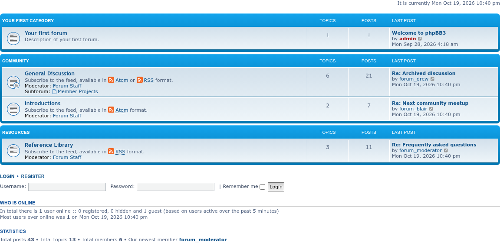
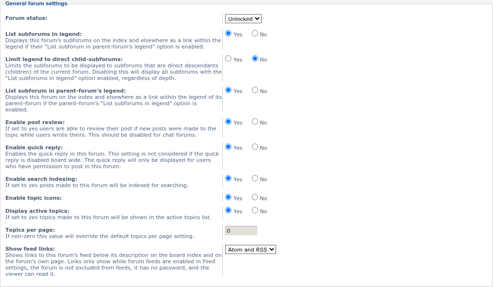

# Feed Links

 

Adds RSS 2.0 versions of phpBB's Atom feeds and shows Atom, RSS or both feed links on the forums you choose.

## Features

- **RSS 2.0 feeds** for every feed phpBB offers as Atom: the board, a forum, a topic, news, all forums, new topics and active topics. They follow phpBB's own feed settings and permissions; a feed that is off or not allowed in Atom is off or not allowed in RSS too.
- A **Show feed links** setting for each forum (**ACP → Forums → Edit forum**): none, Atom, RSS, or both. New forums start with none.
- The links show below the forum's description on the board index and in subforum lists, and on the forum's own page: "Subscribe to the feed, available in Atom or RSS format", as on phpBB.com.
- Links only show when the feed works for the viewer: forum feeds on, the forum not excluded from feeds, no forum password, and the viewer can read the forum.
- Adds the forum's and topic's RSS feeds to the page head, next to phpBB's Atom ones, so browsers and feed readers can find them. A setting under **ACP → Feed settings** adds the board-wide RSS feeds there too.
- phpBB's HTTP authentication for feeds works for the RSS feeds as well.

## Screenshots

<table>
<tr>
<td></td>
<td></td>
</tr>
</table>

Click an image for the full size. See the [screenshot gallery](docs/images/screenshots/README.md) for the rest.

## Requirements

- phpBB 3.3.19 or later, including phpBB 4.0 (tested on its 4.0.0-a3 development version)
- PHP 7.4 or later (phpBB 4.0 itself needs PHP 8.2 or later), with the DOM extension

## Installation

1. Copy the extension to `/ext/phpbbmodders/feedlinks`
2. In the Administration Control Panel, go to **Customise → Manage extensions**
3. Enable the **Feed Links** extension
4. Choose the links each forum shows under **ACP → Forums → Edit forum → Show feed links**

## Usage

The RSS feeds sit next to phpBB's Atom feeds, with `rss` in place of `feed`:

| Feed | Atom (phpBB) | RSS (this extension) |
|------|--------------|----------------------|
| Board | `app.php/feed` | `app.php/rss` |
| Forum | `app.php/feed/forum/2` | `app.php/rss/forum/2` |
| Topic | `app.php/feed/topic/5` | `app.php/rss/topic/5` |
| News | `app.php/feed/news` | `app.php/rss/news` |
| All forums | `app.php/feed/forums` | `app.php/rss/forums` |
| New topics | `app.php/feed/topics` | `app.php/rss/topics` |
| Active topics | `app.php/feed/topics_active` | `app.php/rss/topics_active` |

phpBB 4.0 leaves out `app.php/` on boards that hide it, for example `/rss/forum/2`.

## Contributing

Contributions are welcome!

- **Bug reports**: [Open an issue](https://github.com/phpbbmodders/feedlinks/issues).
- **Everything else** (questions, feature requests, ideas, general discussion): [Use Discussions](https://github.com/orgs/phpbbmodders/discussions), or the [community forum](https://www.phpbbmodders.com/community/).
- Pull requests are welcome for bug fixes or discussed features.

## Acknowledgments

- Code, tests and documentation written with [Claude](https://www.anthropic.com/claude).

## License

This extension is licensed under the **GNU General Public License v2.0**.

See [license.txt](license.txt) for more information.
