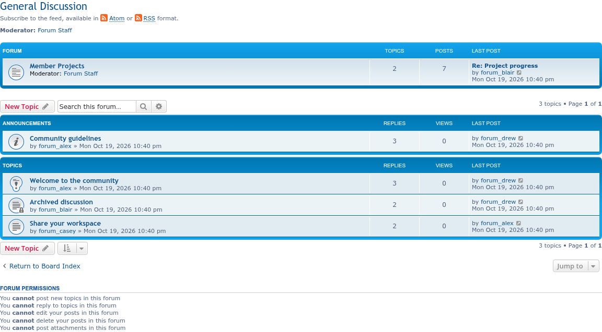
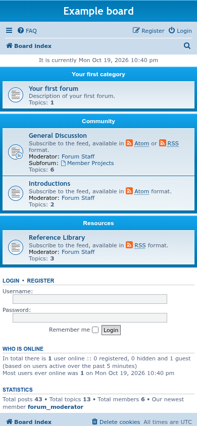
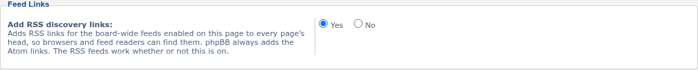

# Screenshots

Taken on phpBB 3.3 with prosilver, using `phpbb-test-board/screenshots.py` from [phpbb-release-tools](https://github.com/phpbbmodders/phpbb-release-tools). Click an image for the full size.

## Board index

Three forums set to show RSS, Atom, and both feed links.

## Forum page

The links on the forum's own page, below its title.

## Phone

The board index at phone width.

## ACP: forum setting

**Show feed links**, at the end of a forum's general settings in **ACP → Forums → Edit forum**.

## ACP: feed settings

The extension's section at the end of **ACP → Feed settings**.

