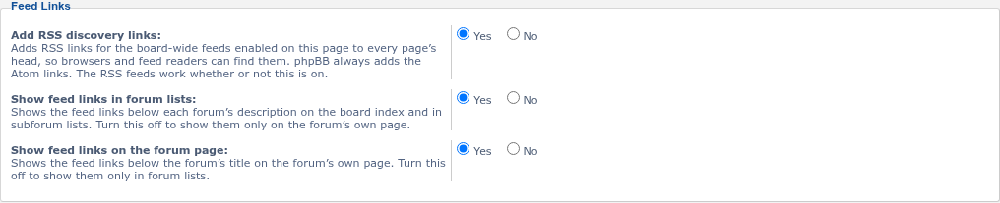
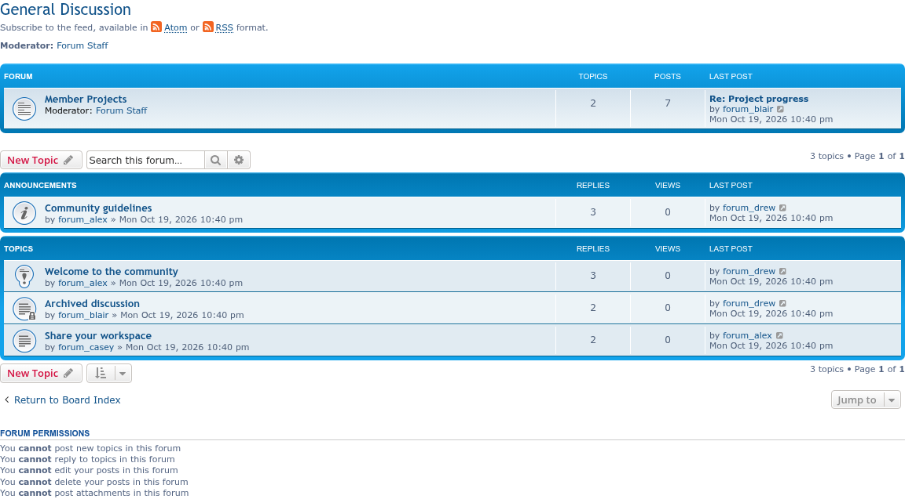

# Feed Links update screenshots — 11/24/2026

The new **Show feed links in forum lists** and **Show feed links on the forum page** settings, under **ACP → Feed settings**. Both are on by default, so existing boards look the same until one is switched off.

The feed links on a forum's own page. With the forum-list setting switched off, this is the only place the links show, and they no longer repeat in every forum-list row.

